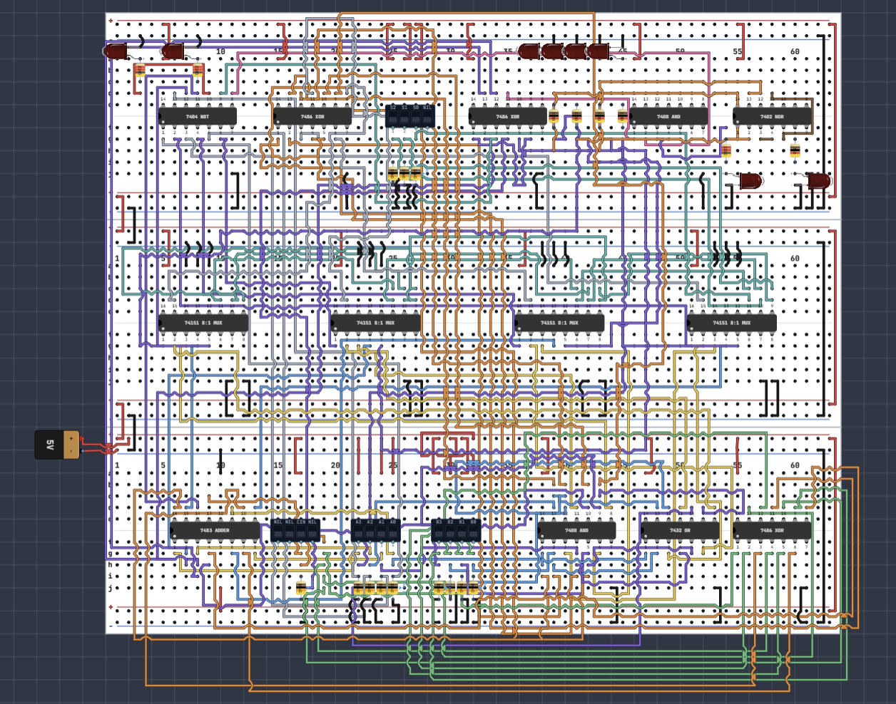

# 4-Bit Arithmetic Logic Unit (ALU)

A **4-bit Arithmetic Logic Unit (ALU)** designed in **Logisim Evolution** and implemented as a TTL breadboard circuit in **Logic Bench**.

The ALU operates on two 4-bit inputs, `A3 A2 A1 A0` and `B3 B2 B1 B0`, and produces a 4-bit result, `Y3 Y2 Y1 Y0`. It supports arithmetic and bitwise logic operations selected using three control lines (`S2`, `S1`, `S0`).

> **Project status:** The circuit connections and overall ALU design are correct. The Logisim Evolution design is the reference implementation. The Logic Bench breadboard implementation follows the same circuit connections, but is currently a work in progress and is being debugged for complete functional verification.

---

## Features

- 4-bit addition
- 4-bit subtraction using two's-complement arithmetic
- Bitwise AND
- Bitwise OR
- Bitwise NOT of operand A
- Bitwise XOR
- Carry-out indication
- Borrow indication
- Signed overflow detection
- Zero-result detection
- 3-bit operation selection using 8-to-1 multiplexers

---

## Operation Table

| S2 | S1 | S0 | Cin | Operation | Result |
|:--:|:--:|:--:|:--:|---|---|
| 0 | 0 | 0 | 0 | Addition | `A + B` |
| 0 | 0 | 0 | 1 | Subtraction | `A - B` |
| 0 | 0 | 1 | X | AND | `A AND B` |
| 0 | 1 | 0 | X | OR | `A OR B` |
| 0 | 1 | 1 | X | NOT | `NOT A` |
| 1 | 0 | 0 | X | XOR | `A XOR B` |
| 1 | 0 | 1 | X | Unused | — |
| 1 | 1 | 0 | X | Unused | — |
| 1 | 1 | 1 | X | Unused | — |

`X` = don't care for the selected logical operation.

---

## Block Diagram


The design can be divided into four major sections:

1. **Arithmetic Unit** — performs addition and subtraction.
2. **Logic Unit** — performs AND, OR, NOT A and XOR.
3. **Output Selection Unit** — selects the required result using four 8-to-1 multiplexers.
4. **Status Logic** — provides Carry, Borrow, Overflow and Zero Flag indications.

---

## Arithmetic Unit

### Addition

For:

```text
S2 S1 S0 = 000
Cin       = 0
```

the ALU performs:

```text
Y = A + B
```

The 4-bit result is displayed at `Y3 Y2 Y1 Y0`. A carry beyond the most significant bit is indicated by the **Cout** output.

### Subtraction

For:

```text
S2 S1 S0 = 000
Cin       = 1
```

subtraction is implemented using two's-complement arithmetic:

```text
A - B = A + NOT(B) + 1
```

The B inputs are conditionally inverted using XOR gates:

```text
B'i = Bi XOR Cin
```

Therefore, when `Cin = 1`, the B operand is complemented and the carry input supplies the additional `1` required for two's-complement subtraction.

The result appears at `Y3 Y2 Y1 Y0`, while the **Borrow** output indicates an unsigned borrow condition.

---

## Logic Operations

### AND — `001`

Performs a bitwise AND between A and B:

```text
Y = A AND B
```

### OR — `010`

Performs a bitwise OR between A and B:

```text
Y = A OR B
```

### NOT A — `011`

Complements operand A:

```text
Y = NOT A
```

Only operand **A** is complemented in this design.

### XOR — `100`

Performs a bitwise exclusive-OR between A and B:

```text
Y = A XOR B
```

---

## Output Selection

Four **8-to-1 multiplexers (74151)** are used to select the final ALU result.

Each multiplexer is responsible for one output bit:

| Multiplexer | Output |
|---|:---:|
| MUX 1 | `Y0` |
| MUX 2 | `Y1` |
| MUX 3 | `Y2` |
| MUX 4 | `Y3` |

All four multiplexers share the selection inputs `S2`, `S1`, and `S0`, allowing the selected arithmetic or logic result to appear simultaneously at the four output bits.

---

## Status Outputs

### Carry Out

During addition, `Cout` indicates a carry beyond the most significant bit.

### Borrow

For subtraction implemented using two's-complement addition, the unsigned borrow indication is derived from the final carry:

```text
Borrow = NOT(Cout)
```

### Zero Flag

The **Zero Flag** is asserted when all four result bits are zero:

```text
Zero Flag = NOT(Y3 OR Y2 OR Y1 OR Y0)
```

Therefore:

```text
Y = 0000  -> Zero Flag = 1
Y != 0000 -> Zero Flag = 0
```

### Overflow Flag

The **Overflow Flag** detects signed arithmetic overflow. In this design, the overflow-detection logic is implemented as:

```text
Overflow = (A3 XOR S3) AND (A3 XOR B'3)
```

where:

- `A3` is the most significant (sign) bit of operand A.
- `S3` is the most significant (sign) bit of the arithmetic result.
- `B'3` is the modified MSB of operand B after the ADD/SUB XOR stage.

The **Overflow LED** indicates when the overflow-detection logic is asserted. For a signed 4-bit two's-complement result, the representable range is:

```text
-8 to +7
```

---

## Logisim Evolution Design


The complete ALU was first designed in **Logisim Evolution**. This implementation is used as the reference design for verifying individual operations and debugging the breadboard implementation.

### Annotated Design


The annotated schematic separates the arithmetic, logic, multiplexer and status-detection sections for easier understanding of the overall architecture.

The Logisim `.circ` source file is available in the [`simulation`](simulation/) directory.

---

## Logic Bench / Breadboard Implementation



The ALU architecture was also recreated using TTL ICs and breadboard-style wiring in **Logic Bench**.

### Current Status

The **circuit connections and intended logic are correct and follow the Logisim design**. The breadboard implementation is currently **under development and debugging** because some sections are not yet producing the expected output consistently.

This means the current issue is with functional verification/debugging of the breadboard implementation rather than the intended ALU connection scheme. The working Logisim Evolution circuit is used as the reference when testing each breadboard subsystem.

### Debugging Checklist

- [ ] Verify all four addition output bits
- [ ] Verify `Cout`
- [ ] Verify subtraction
- [ ] Verify Borrow indication
- [ ] Verify AND operation
- [ ] Verify OR operation
- [ ] Verify NOT A operation
- [ ] Verify XOR operation
- [ ] Verify Zero Flag
- [ ] Verify Overflow Flag
- [ ] Complete full-system testing

The checklist can be updated as each section is verified.

---

## ICs Used

| IC | Description | Purpose |
|---|---|---|
| 7483 | 4-bit binary full adder | Addition and subtraction |
| 74151 | 8-to-1 multiplexer | Output/function selection |
| 7486 | Quad 2-input XOR | XOR operation and conditional B inversion |
| 7408 | Quad 2-input AND | AND operation / supporting logic |
| 7432 | Quad 2-input OR | OR operation |
| 7404 | Hex inverter | NOT operation / supporting logic |
| 7402 | Quad 2-input NOR | Zero-detection logic |

---

## Example Test Cases

| A | B | S2S1S0 | Cin | Operation | Expected Y |
|:---:|:---:|:---:|:---:|---|:---:|
| `0011` | `0010` | `000` | 0 | 3 + 2 | `0101` |
| `0101` | `0011` | `000` | 1 | 5 - 3 | `0010` |
| `1010` | `1100` | `001` | X | AND | `1000` |
| `1010` | `1100` | `010` | X | OR | `1110` |
| `1010` | — | `011` | X | NOT A | `0101` |
| `1010` | `1100` | `100` | X | XOR | `0110` |

Additional test cases can be added as the hardware implementation is verified.

---

## Running the Logisim Simulation

1. Install **Logisim Evolution**.
2. Clone or download this repository.
3. Open `simulation/4-bit-ALU.circ`.
4. Set the inputs `A3-A0` and `B3-B0`.
5. Set `S2 S1 S0` according to the operation table.
6. For arithmetic mode (`000`):
   - `Cin = 0` -> Addition
   - `Cin = 1` -> Subtraction
7. Observe `Y3-Y0` and the relevant status outputs.

---

## Repository Structure

```text
4-Bit-ALU/
|
|-- README.md
|-- LICENSE
|
|-- simulation/
|   `-- 4-bit-ALU.circ
|
|-- images/
|   |-- block-diagram.png
|   |-- logisim-layout.png
|   |-- logisim-annotated.png
|   `-- breadboard-implementation.png
|
`-- hardware/
    `-- README.md
```

---

## Future Improvements

- Complete debugging and verification of the Logic Bench implementation
- Utilize the unused ALU selection combinations for additional operations
- Add operations such as NAND, NOR or comparison
- Improve modularity of the hardware implementation
- Expand the architecture from 4 bits to 8 bits
- Add additional status indicators
- Document a complete set of test vectors

---

## License

This project is licensed under the **MIT License**. See the `LICENSE` file for details.

---

## Acknowledgements

Designed as a digital electronics project to explore the internal architecture of an Arithmetic Logic Unit using basic TTL logic ICs, multiplexers and a binary adder.
